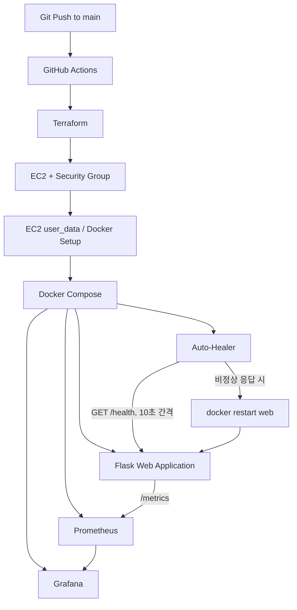
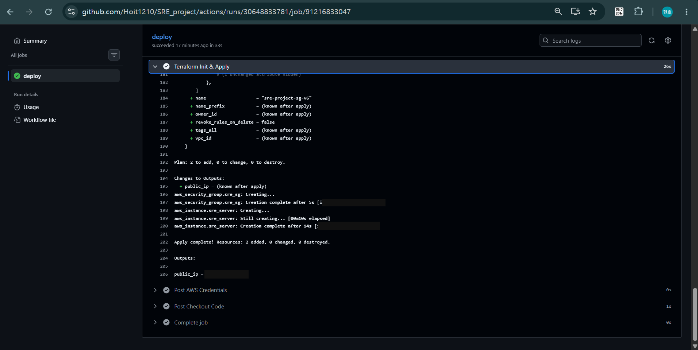
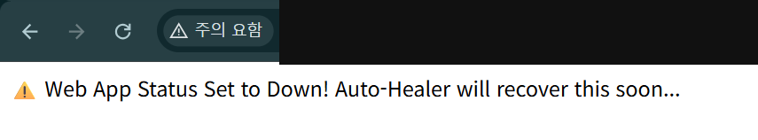
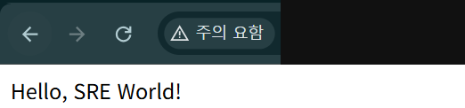
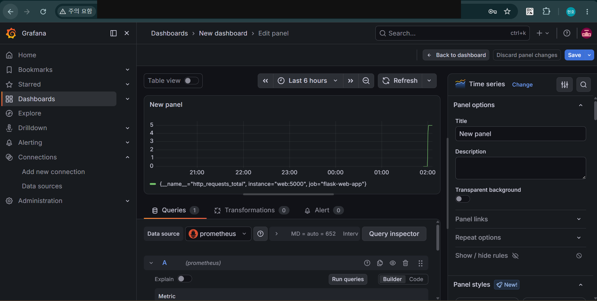

# Project 04. IaC 기반 Auto-Healing SRE Monitoring System

> Terraform과 GitHub Actions로 AWS 인프라 배포를 자동화하고, Prometheus 모니터링 및 컨테이너 Health Check를 통해 장애 감지·재시작을 연결한 개인 프로젝트입니다.

## Project Context

앞선 프로젝트에서는 클라우드 인프라 구축, 접근 통제, 장애 Context 분석과 대응 흐름을 구현했습니다. 그러나 인프라 생성과 애플리케이션 복구 과정에는 여전히 반복적인 수동 작업이 남아 있었습니다.

이 프로젝트의 목표는 두 가지입니다.

1. 배포 자동화: Git Push → GitHub Actions → Terraform → AWS EC2
2. 컨테이너 복구 자동화: Health Check → 비정상 상태 감지 → Docker Restart

> Auto-Healing 범위는 단일 EC2 내 컨테이너 재시작 수준의 프로토타입입니다. AWS 인프라 전체 장애를 자동 복구하는 플랫폼은 아닙니다.

## Architecture




## 구성도

[클라우드 구성도와 구성 요소 설명](docs/cloud-architecture.md)

## 대표 검증 화면

클라우드 인프라 구축과 운영 점검 과정에서 남긴 실제 실행 화면입니다. 공개용 캡처는 민감정보를 가렸으며, 설명은 화면에서 확인할 수 있는 범위로 작성했습니다.

[전체 검증 화면 5개와 확인 범위](docs/evidence-gallery.md)

### GitHub Actions 배포

GitHub Actions 배포 작업 성공과 Terraform의 Resources: 2 added 결과를 확인했습니다. 리소스 식별자와 공인 IP는 가렸습니다.



### 장애 주입

/kill 요청 후 애플리케이션이 장애 상태로 전환됐다는 응답입니다. 이 화면 자체는 HTTP 상태 코드나 복구 완료를 보여 주지 않습니다.



### 복구 후 응답

장애 주입 이후 애플리케이션이 Hello, SRE World!를 반환한 화면입니다. 두 캡처만으로 자동 재시작의 실행 로그나 정확한 복구 시간을 확인할 수는 없습니다.



### 복구 이후 모니터링

복구 이후 Grafana에서 요청 카운터 변화가 표시됩니다. 복구 시간 보장이나 무중단 운영을 의미하지 않습니다.



## Tech Stack

| 구분 | 기술 | 목적 |
|---|---|---|
| Cloud | AWS EC2, Security Group | 애플리케이션 실행 인프라 |
| IaC | Terraform | AWS 리소스 선언·생성 |
| CI/CD | GitHub Actions | Push 이후 Terraform 실행 |
| Bootstrap | EC2 user_data | Docker 설치 및 서비스 기동 |
| Container | Docker, Docker Compose | 다중 서비스 실행 |
| Application | Python, Flask | 서비스 및 Health/Metrics Endpoint |
| Monitoring | Prometheus, Grafana | 애플리케이션 지표 수집·시각화 |
| Recovery | Python Auto-Healer | 상태 검사 후 컨테이너 재시작 |

## Core Engineering Decisions

| 문제 | 적용한 기술/방법 | 목적 |
|---|---|---|
| AWS 리소스 수동 생성 | Terraform | 인프라 구성을 코드로 관리 |
| Terraform 명령 수동 실행 | GitHub Actions | Repository 변경과 배포 연결 |
| EC2 초기 수동 설정 | user_data | 인스턴스 부팅 단계 자동화 |
| 서비스 실행 및 관리 복잡성 | Docker Compose | 애플리케이션·모니터링 서비스 구성 |
| 장애 발생 후 수동 재시작 | `/health` + Auto-Healer | 비정상 상태 인지 및 컨테이너 재시작 |
| 애플리케이션 관측 부족 | `/metrics`, Prometheus, Grafana | 지표 수집 및 시각화 |

## Implementation & Validation

### 1. Infrastructure as Code
- `main.tf`에 EC2와 Security Group을 정의했습니다.
- `main` 브랜치 Push를 트리거로 GitHub Actions가 `terraform init`, `terraform apply -auto-approve`를 실행합니다.
- EC2 부팅 시 `user_data`가 Docker/Compose를 준비하고 저장소를 Clone한 뒤 컨테이너를 기동하도록 구성했습니다.

### 2. Monitoring
- Flask 애플리케이션은 `/metrics`를 제공합니다.
- Prometheus는 5초 간격으로 지표를 수집하고 Grafana에서 확인할 수 있도록 구성했습니다.

### 3. Health-based Auto-Healing
- Auto-Healer가 10초 간격으로 `/health` 상태를 확인합니다.
- 응답이 비정상이면 Docker Socket을 이용해 `web` 컨테이너 재시작을 시도합니다.
- 10초는 검사 주기이며, 실제 복구 완료 시간 또는 보장된 MTTR 수치가 아닙니다.

### 4. Controlled Failure Injection
- `/kill` Endpoint를 이용해 애플리케이션의 Health 상태를 비정상으로 전환하는 모의 장애 흐름을 구성했습니다.
- `/health`가 HTTP 500을 반환하도록 하여 장애 감지와 재시작 경로를 검증하도록 설계했습니다.
- 실제 운영 장애나 광범위한 인프라 장애를 재현한 것은 아닙니다.

## Repository Structure

```text
.github/workflows/deploy.yml  # GitHub Actions 배포
main.tf                       # Terraform AWS 리소스
app.py                        # Flask Web / Health / Metrics
healer.py                     # 컨테이너 상태 확인·재시작
Dockerfile                    # App 이미지
docker-compose.yml            # 서비스 구성
prometheus.yml                # 수집 설정
docs/                         # 아키텍처·제약 사항
README.md
```

## 주요 보안·운영상 한계

| 항목 | 현재 상태 | 개선 방향 |
|---|---|---|
| AWS 인증 | GitHub Secrets의 장기 IAM Access Key 사용 | GitHub OIDC + IAM Role |
| 인바운드 보안 | 22, 5000, 3000, 9090 포트를 `0.0.0.0/0`에 허용 | 신뢰 IP 제한, Monitoring 비공개 |
| Docker Socket | Auto-Healer가 Docker Socket에 접근 | 권한 경계를 제한한 복구 방식 |
| 장애 복구 범위 | 단일 EC2의 컨테이너 재시작 | ECS/ASG/Kubernetes 등 플랫폼 복구 |
| 복구 정책 | 주기적 상태 확인 후 Restart | 재시도 한도, Backoff, 반복 장애 감지 |
| 가용성 | 단일 인스턴스에 의존 | 다중 인스턴스·AZ 검토 |

> 이 저장소의 현재 Security Group 및 인증 설정은 실서비스 권장 설정이 아닙니다. 별도 보안 강화 없이 공개 배포하지 마세요.

상세 설명: [Limitations and Security Notes](docs/limitations.md)

## Results & Scope

- 이 저장소는 배포 자동화 및 컨테이너 수준 장애 복구 구조를 구현·검증하기 위한 포트폴리오 프로토타입입니다.
- 장애 감지와 컨테이너 Restart 흐름을 다루지만 무중단 운영, 10초 이내 복구 보장, MTTR 개선 수치, EC2 자체 장애 자동 복구를 주장하지 않습니다.
- 실제 장애 테스트 기록, Grafana 화면, Workflow 실행 캡처는 아래 대표 검증 화면과 전체 갤러리에서 확인할 수 있습니다.

## Portfolio

[Project 04 Notion Portfolio](https://app.notion.com/p/3b059c94122580ca9c23f4efac60b2a7)

Project 01 BUILD → Project 02 SECURE → Project 03 OBSERVE & RESPOND → Project 04 AUTOMATE

> GitHub는 코드·인프라 구성과 구현 근거, Notion은 설계 배경·검증 기록·개선점을 설명하는 역할로 사용합니다.


---

## 구축 및 검증 기록

[개인 프로젝트 관리 — Project 04 Auto-Healing](https://app.notion.com/p/3b659c94122580cd81d6d0d249ebde89)에 구축 과정과 장애 주입 전후 캡처가 보관되어 있습니다.

| 구성 요소 | 노션의 실제 확인 기록 | 확인할 위치 |
|---|---|---|
| AWS 인프라 배포 | GitHub Actions의 Terraform Apply 결과 및 AWS 리소스 생성 | IaC & Infrastructure Deployment |
| 모니터링 | Prometheus `http_requests_total` 조회, Grafana 시각화 | Observability |
| 장애 주입 | `/kill` 실행으로 애플리케이션의 비정상 상태 생성 | Failure & Recovery Validation |
| 자동 복구 | Auto-Healer 조치 이후 애플리케이션 정상 응답 | Failure & Recovery Validation |
| 사후 상태 | 복구 이후 애플리케이션 요청 메트릭 변화 | Failure & Recovery Validation |

### 클라우드 아키텍처 구성도 해석

README 상단 다이어그램의 GitHub Actions → Terraform → EC2/Security Group는 클라우드 리소스 배포 경로입니다. EC2 user_data → Docker Compose는 인스턴스 부팅 이후 런타임 구성이며, Prometheus/Grafana는 메트릭 확인, Auto-Healer/Docker Socket은 컨테이너 재시작 경로입니다.

각 단계는 역할이 다릅니다. 10초 주기는 Health Check 간격이지 복구 완료 시간이나 SLA가 아니며, 실제 테스트에서 확인한 것은 컨테이너 수준 정상 응답 복원입니다. 원본 캡처와 기록을 확인할 수 있도록 링크를 유지합니다.

[구축 및 검증 화면 목록](docs/evidence-gallery.md)

