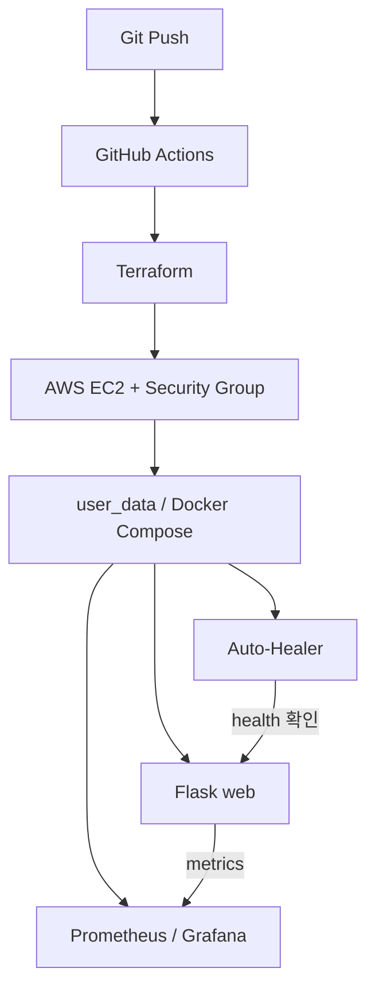

# 클라우드 구성도

EC2 한 대에서 웹 애플리케이션과 모니터링 및 상태 감시 컨테이너를 실행하는 구성입니다.

상태 확인은 10초 간격입니다. 이는 복구 시간을 보장하지 않습니다.

[노션 구축과 검증 기록](https://app.notion.com/p/3b659c94122580cd81d6d0d249ebde89)

현재 저장소의 감시 컨테이너 설정은 Docker 명령 실행 환경을 재점검해야 합니다. 성공 화면과 코드의 재현성은 별도 확인 대상입니다.
