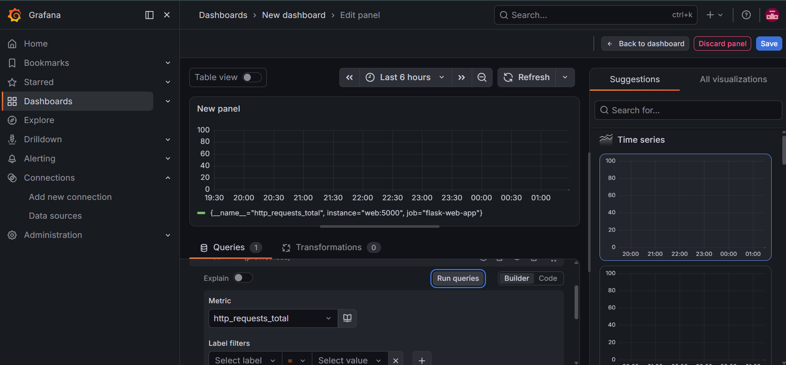

# 구축 및 검증 화면

프로젝트 진행 당시 노션에 보관한 실행 화면입니다. 캡처에서 확인할 수 있는 결과를 중심으로 정리했습니다. 현재 서비스를 다시 실행해 검증한 기록은 아닙니다.

공개용 사본에는 AWS 계정 식별자, 공인 IP, 인증 토큰 등 노출을 피해야 하는 부분을 불투명하게 가렸습니다. localhost·루프백 주소와 문서용 테스트 주소는 유지했습니다.

## GitHub Actions 배포

GitHub Actions 배포 작업 성공과 Terraform의 Resources: 2 added 결과를 확인했습니다. 리소스 식별자와 공인 IP는 가렸습니다.

## Grafana에서 Prometheus 메트릭 조회

Grafana 편집 화면에서 Prometheus의 http_requests_total 메트릭을 조회한 기록입니다. Prometheus 서버 UI 캡처는 아닙니다.

## 장애 주입

/kill 요청 후 애플리케이션이 장애 상태로 전환됐다는 응답입니다. 이 화면 자체는 HTTP 상태 코드나 복구 완료를 보여 주지 않습니다.

## 복구 후 응답

장애 주입 이후 애플리케이션이 Hello, SRE World!를 반환한 화면입니다. 두 캡처만으로 자동 재시작의 실행 로그나 정확한 복구 시간을 확인할 수는 없습니다.

## 복구 이후 모니터링

복구 이후 Grafana에서 요청 카운터 변화가 표시됩니다. 복구 시간 보장이나 무중단 운영을 의미하지 않습니다.

[프로젝트 설명으로 돌아가기](../README.md)
